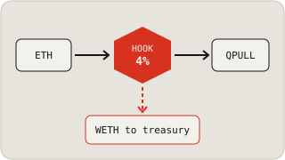
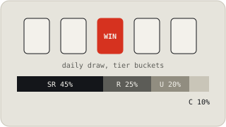
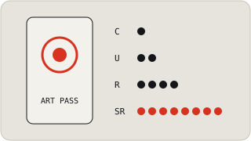
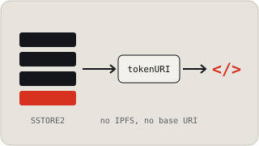
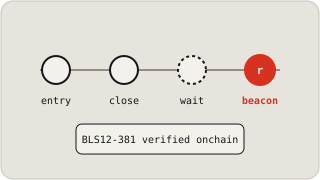
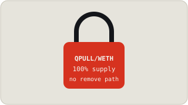
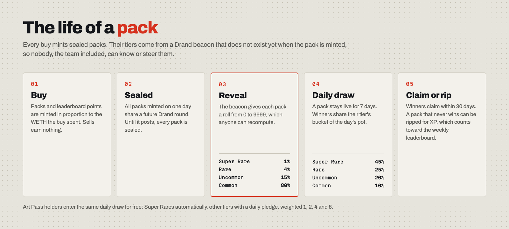
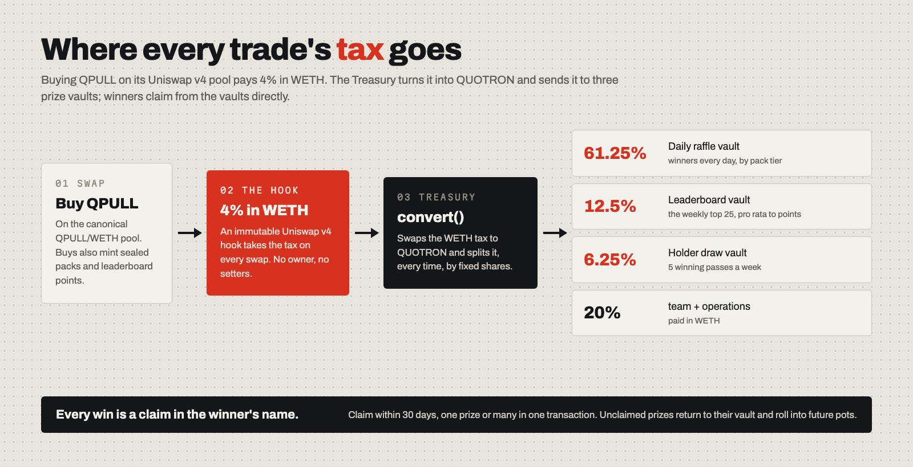
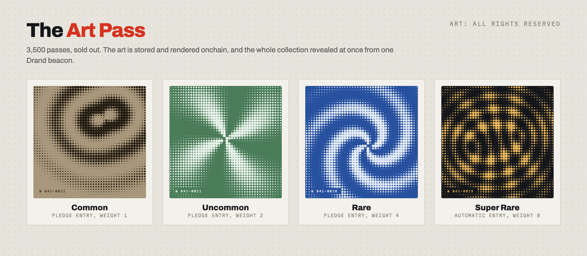
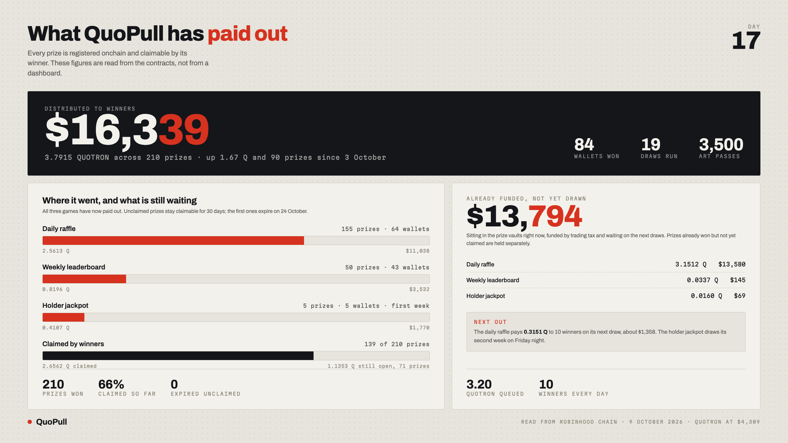

<p align="center">
  <a href="https://www.quopull.fun"></a>
</p>

<p align="center">
  <a href="https://www.quopull.fun"><b>quopull.fun</b></a> &nbsp;·&nbsp;
  <a href="#how-it-works">How it works</a> &nbsp;·&nbsp;
  <a href="#contracts">Contracts</a> &nbsp;·&nbsp;
  <a href="docs/DEPLOYMENTS.md">Addresses</a> &nbsp;·&nbsp;
  <a href="#security">Security</a> &nbsp;·&nbsp;
  <a href="docs/README.md">Docs</a> &nbsp;·&nbsp;
  <a href="#for-developers">For developers</a>
</p>

<p align="center">
  
  
  
  
  
</p>

# QuoPull

QuoPull is a pack raffle on Robinhood Chain (chain id 4663), live on mainnet since September 2026. Buying QPULL on
its Uniswap v4 pool pays a 4% tax in WETH and mints sealed packs that reveal a tier from a future Drand beacon. The
Treasury converts the tax into QUOTRON, an external prize token, and three games pay it out: a daily raffle, a weekly
leaderboard and a weekly draw for Art Pass holders. Prizes sit in three vaults until the winner claims them, within
30 days.

**What is fixed, and what is not**

- **No owner** on the tax hook or the QPULL token, and no setters.
- **Locked liquidity:** 100% of the QPULL supply was seeded into the pool through a lock with no remove path.
- **Verifiable randomness:** every random number is a Drand beacon, verified onchain.
- **The owner key can** tune a few game parameters inside fixed bounds (each moves at most 25% per change, with a
  cooldown of a day or a week between changes), bar an address from the holder draw with a week's notice, manage
  operational settings such as which keeper may call the Treasury's `convert()`, and replace the Treasury's swap
  adapter only after a 7-day timelock.
- **The owner key cannot** change the tax, remove the liquidity, mint QPULL or move prizes that are owed to winners.

<table>
  <tr>
    <td width="33%" valign="top">
      <br>
      <b>A tax that lives in the pool</b><br>
      An immutable Uniswap v4 hook takes the tax in WETH on every kind of swap and credits packs and points from the
      fee it actually took. No owner, no setters.
    </td>
    <td width="33%" valign="top">
      <br>
      <b>Packs and the daily raffle</b><br>
      Every buy mints sealed packs. Each day a draw picks winners with equal odds per pack; the tier a pack revealed
      decides which prize bucket pays it.
    </td>
    <td width="33%" valign="top">
      <br>
      <b>Art Pass entries</b><br>
      Passes enter the same daily draw for free: Super Rares automatically, other tiers by a daily pledge, weighted
      1, 2, 4 and 8. Holding 4 or more passes enters the weekly holder draw.
    </td>
  </tr>
  <tr>
    <td width="33%" valign="top">
      <br>
      <b>Art that lives onchain</b><br>
      The pass artwork is stored in SSTORE2 chunks and rendered by <code>tokenURI</code>. The whole collection
      revealed at once from one beacon, with no IPFS and no base URI to change.
    </td>
    <td width="33%" valign="top">
      <br>
      <b>Drand randomness</b><br>
      Every draw is bound to a Drand round that is still in the future when entries close. The oracle checks each
      beacon's BLS12-381 signature onchain, so no relayer is trusted.
    </td>
    <td width="33%" valign="top">
      <br>
      <b>A lock with no way out</b><br>
      The liquidity lock created the pool and seeded the full supply plus the mint's LP ETH in one transaction. It
      has no remove, withdraw or collect function at all.
    </td>
  </tr>
</table>

## How it works

1. **Mint an Art Pass.** 3,500 passes were minted in September 2026 and the collection is sold out. Mint proceeds
   split 80% to liquidity, 10% to the first prize pot and 10% to team + operations. Every pass revealed its rarity
   at the same moment from one Drand beacon.
2. **Buy QPULL.** Swaps go through the canonical QPULL/WETH pool on Uniswap v4. The hook takes 4% of every buy in
   WETH. Sells paid a higher tax for the first 48 hours after launch (20% stepping down to 4%) and pay 4% since.
3. **Get packs and points.** A buy mints sealed packs and leaderboard points in proportion to the WETH it spent,
   computed from the tax the hook took. Sells earn nothing.
4. **Packs reveal.** All packs minted on one day share a future Drand round. When it posts, each pack shows a roll
   from 0 to 9999 and a tier: Super Rare 1%, Rare 4%, Uncommon 15%, Common 80%. Anyone can recompute the roll.
5. **The daily raffle.** Each day the previous day's draw picks winners from every live pack (a pack stays live for
   7 days) plus the free pass entries. Winners share their tier's bucket of the pot: Super Rare 45%, Rare 25%,
   Uncommon 20%, Common 10%. A draw that is missed or too small rolls the pot forward.
6. **The weekly games.** Points from buys and from ripping losing packs feed a weekly leaderboard: the top 25 are
   paid pro rata to their share of all of that week's points. Wallets that have held 4 or more passes continuously
   since the week's freeze enter the holder draw, which pays 5 winning passes an equal fifth of its pot.
7. **Claim.** Every win writes a claim in the winner's name. One transaction collects it, or many at once, within
   30 days. Unclaimed prizes return to the vault and roll into future pots.
8. **Where the tax goes.** A keeper calls the Treasury's `convert()`, which turns the WETH tax into QUOTRON and
   splits it: daily raffle 61.25%, leaderboard 12.5%, holder draw 6.25%, team + operations 20%. So 80% of every
   trade tax becomes prizes.

<p align="center"></p>

<p align="center"></p>

The full walkthrough, with every number, is in [`docs/PROTOCOL-WALKTHROUGH.md`](docs/PROTOCOL-WALKTHROUGH.md). The
original design specification is [`docs/DESIGN-SPEC.md`](docs/DESIGN-SPEC.md); when a code comment says
"spec §N", it means a section of that file.

## The Art Pass

<p align="center"></p>

The Art Pass is the holder pass. Its art lives onchain in [`nft/PassArtRenderer`](src/nft/PassArtRenderer.sol), and
every pass enters the daily draw for free, weighted by its tier. The art is all rights reserved (see
[`ART-LICENSE.md`](ART-LICENSE.md)).

## By the numbers

<p align="center"></p>

A snapshot read from the contracts on 9 October 2026, day 17 after the token launched. Every figure comes from
onchain events and vault balances; the live numbers are on [quopull.fun](https://www.quopull.fun).

## Contracts

| Contract | Role |
|---|---|
| [`hooks/QpullTaxHook`](src/hooks/QpullTaxHook.sol) | The tax. A Uniswap v4 hook on the canonical QPULL/WETH pool: takes the tax in WETH, credits packs and points, gates liquidity to the lock, and enforced the 1-hour holder-only launch window. Immutable. |
| [`QPULLToken`](src/QPULLToken.sol) | A plain, ownerless ERC-20 with a fixed supply of 1,000,000,000. It does not tax transfers. |
| [`QpullLiquidityLock`](src/QpullLiquidityLock.sol) | Created the pool and seeded the full supply. No remove, withdraw or collect path. See [`docs/LIQUIDITY-LOCK-SPEC.md`](docs/LIQUIDITY-LOCK-SPEC.md). |
| [`periphery/QpullSwapRouter`](src/periphery/QpullSwapRouter.sol) | The website's buy and sell path: ETH in and out, taxed like any swapper, a non-zero minimum and a deadline on every trade, holds nothing between calls, no owner. |
| [`Treasury`](src/Treasury.sol) | Converts the WETH tax to QUOTRON through two swap adapters and splits it to the three vaults and team + operations. |
| [`BaseVault`](src/BaseVault.sol) (x3) | Hold QUOTRON prize inventory for one game each, with one immutable controller and a solvency check that keeps owed prizes reserved. |
| [`PackRegistry`](src/PackRegistry.sol) | Mints packs on buys, seals their tiers to a future beacon, runs the daily draw selection including free pass entries, and banks rip points for losing packs. See [`docs/PLEDGE-ENTRY-SPEC.md`](docs/PLEDGE-ENTRY-SPEC.md). |
| [`RaffleEngine`](src/RaffleEngine.sol) | The daily draw: pot snapshot, tier buckets, winners, claims. |
| [`LeaderboardRegistry`](src/LeaderboardRegistry.sol) and [`LeaderboardEngine`](src/LeaderboardEngine.sol) | The weekly points board and its pro-rata payout. |
| [`HolderDrawEngine`](src/HolderDrawEngine.sol) | The weekly holder draw: 5 winning passes, eligibility frozen before the beacon is known. |
| [`ClaimManager`](src/ClaimManager.sol) | Pull claims for every game, a 30-day window, and the sweep of expired claims back to their vault. |
| [`NFTCollection`](src/NFTCollection.sol) | The Art Pass: a time-boxed mint that closed itself, onchain rarity, and the hold clocks the holder draw reads. |
| [`nft/PassArtRenderer`](src/nft/PassArtRenderer.sol) | Renders the pass art onchain from SSTORE2 data. |
| [`oracle/BlsDrandOracle`](src/oracle/BlsDrandOracle.sol) | The only randomness source: verifies Drand quicknet beacons onchain with the EIP-2537 BLS12-381 precompiles. |

Every mainnet address, with a link to the explorer, is in [`docs/DEPLOYMENTS.md`](docs/DEPLOYMENTS.md).

## Security

- **The deployed code is this code.** On 2026-10-10 the runtime bytecode of all 19 QuoPull contracts on chain 4663
  was compared with a build of this repository and matched, with constructor immutables masked. The method is in
  [`docs/DEPLOYMENTS.md`](docs/DEPLOYMENTS.md).
- **Tests.** `forge test --no-match-path 'test/fork/*'` runs 845 tests in 73 suites (unit, integration, fuzz and
  invariant), all passing on this tree with forge 1.8.4 on 2026-10-10. The read-only mainnet fork tests in
  `test/fork/` need an RPC.
- **What the owner key can and cannot do** is listed at the top of this page, and every `onlyOwner` function is
  in the source.
- **Audit reports are not published in this repository.**
- **Reporting a vulnerability.** Please do not open a public issue. Use GitHub's private vulnerability reporting
  on this repository.

<a id="for-developers"></a>
<details>
<summary><b>For developers: build, test, deploy</b></summary>

### Layout

```
src/        contracts (core, adapters/, hooks/, interfaces/, nft/, oracle/, periphery/, utils/, testnet/)
test/       unit, integration, fuzz and invariant tests; test/fork/ needs a Robinhood Chain RPC
script/     Foundry deploy and go-live scripts, plus wire-web.mjs (rewires the site from deploy logs)
web/        the static website (no build step) and the art (all rights reserved, see ART-LICENSE.md)
keeper/     the keeper bot that posts beacons, runs draws and converts the tax (Node)
bot/        the read-only bot that posts one summary per draw to X (Node)
tools/      the allowlist builder and the pre-deploy check for the website
docs/       protocol walkthrough, design spec, specs, deployments
```

Start with [`docs/README.md`](docs/README.md) for a map of the documentation, and
[`CONTRIBUTING.md`](CONTRIBUTING.md) before opening a pull request.

### Toolchain

- [Foundry](https://getfoundry.sh) (CI and this export were tested with forge 1.8.4). Solidity 0.8.26 is pinned in
  `foundry.toml` and fetched by forge.
- Node.js 24 for the keeper (`keeper/.node-version`); Node.js 20 or later for the bot (`bot/package.json`).

### Build

```bash
./.github/install-deps.sh   # fetches forge-std, OpenZeppelin 5.1.0 and Uniswap v4-core v4.0.0 into lib/ at pinned commits
forge build                 # via_ir is on: a cold build takes about 30 minutes
```

### Test

```bash
forge test --no-match-path 'test/fork/*'                     # everything that runs locally
RH_RPC_URL=https://rpc.mainnet.chain.robinhood.com \
  forge test --match-path 'test/fork/*'                      # read-only mainnet fork tests
```

The fork tests only read the chain. A public RPC may rate-limit a combined run; running one fork file at a time
avoids that.

### Deploy

Configuration comes from environment variables, documented in [`.env.example`](.env.example). Each script's NatSpec
describes its preconditions and checks. The mainnet deploy ran in this order:

1. `script/DeployOracle.s.sol` (the Drand oracle) and `script/DeployPassArt.s.sol` (the onchain art).
2. `script/DeployNFT.s.sol` (the Art Pass), then the mint and the reveal.
3. `script/Deploy.s.sol` (token, hook, lock, router, Treasury, vaults, engines, claims).
4. `script/GoLiveMainnet.s.sol` (seeds the pool through the lock and locks the routing), then
   `script/SeedRaffleVault.s.sol` (buys the first prize pot).

`script/TransferOwnership.s.sol` moves ownership of the ownable contracts to a Safe and verifies the result.
`script/DeployTestnet.s.sol` and `script/GoLiveTestnet.s.sol` deploy a copy with compressed clocks (a "day" is 5
minutes) from `src/testnet/`; several tests reuse them.

### Keeper and bot

- [`keeper/README.md`](keeper/README.md): what the keeper does each tick, its two hot keys, and how to run it.
- [`keeper/HOSTING.md`](keeper/HOSTING.md): running it unattended.
- [`bot/README.md`](bot/README.md): the read-only bot that posts one summary per draw to X.

### Website

`web/` is static HTML with no build step. Run `node tools/check-web-wiring.mjs` before any deploy: it fails if a
page meant for mainnet still carries testnet wiring.

Page reads go to `READ_RPC` in `web/index.html` and `web/delegate.html` first and fall back to the public node. It
is empty in this repository, so the pages use the public node. A deploy may inject a read endpoint there, but only
one locked to the site's own domain.

### Third-party code

Dependencies are fetched by `install-deps.sh`, not vendored. OpenZeppelin Contracts is MIT; forge-std is MIT or
Apache-2.0. Uniswap v4-core is mixed: `PoolManager.sol`, `libraries/Pool.sol` and `libraries/Position.sol` are
BUSL-1.1, and its `test/` routers are unlicensed. Only files under `test/` and `script/` import those; no contract
under `src/` does.

</details>

## License

The code is released under the [MIT license](LICENSE). The QuoPull art (everything under `web/art/`), the logo, the
wordmark and the social images are **all rights reserved** and are not covered by the MIT license: see
[`ART-LICENSE.md`](ART-LICENSE.md).
